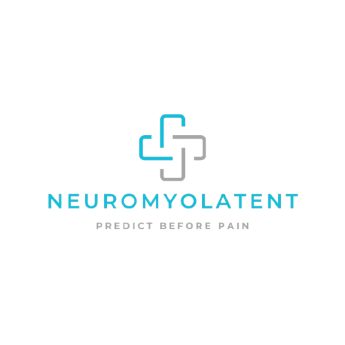

# NEUROMYOLATENT — Physiotherapy Dashboard Prototype

<p align="center">
  
</p>

<p align="center">
  <strong>PREDICT BEFORE PAIN</strong><br>
  <em>Confidentiality-Safe Biomechanical Visualization Prototype & Clinical Demonstration Interface</em>
</p>

<p align="center">
  
  
  
  
  
  
</p>

---

## 1. Executive Summary

The **NEUROMYOLATENT Physiotherapy Dashboard** is a full-stack web application developed according to the specifications in `Basic_Physiotherapy_Dashboard_Prototype_Description.docx`. It provides an intuitive, real-time visualization layer for therapists, clinicians, and demonstration audiences. 

The application synthesizes multi-channel physiological sensor readings into an interactive **2D anatomical muscle map**, responsive statistical cards, multi-channel bar charts, and real-time trajectory graphs.

> **CONFIDENTIALITY BOUNDARY:** This prototype serves solely as an interface and visualization concept. In strict accordance with the product brief, all proprietary AI model weights, inference pipelines, and private patient records are decoupled and excluded. Readings and status classifications follow transparent, documented demonstration rules.

---

## 2. Key Features

### 🧠 Brand & Real-Time Header
- **Official Brand Assets**: Features the official interlocking cross logo and the brand motto **"PREDICT BEFORE PAIN"**.
- **Auditing Telemetry**: Real-time session ID (`DEMO-NML-XXXXXX`), live engine health indicator, and synchronized digital clock.
- **Prominent Compliance**: Visible **`DEMO MODE • ILLUSTRATIVE DATA`** status badge on all screen views and exported reports.

### 🎛️ Demo Controls & Sensor-Style Inputs (Left Panel)
- **6 Repeatable Clinical Scenarios**:
  1. *Resting Baseline (Equilibrium)* — Balanced resting tone across anatomical chains.
  2. *Asymmetric Lumbar & Spine Load* — Elevated lower-back and core stabilizers.
  3. *Cervical & Upper Trapezius Strain* — Scapular elevation and ergonomic strain.
  4. *Post-Rehabilitation Quadriceps Fatigue* — Eccentric loading on knee extensors.
  5. *High-Velocity Dynamic Sprint* — High kinetic power and impact loads across lower limbs.
  6. *Signal Degradation / Artifact Demo* — Electrode detachment demonstration (<35% SNR).
- **Normalized Interactive Sliders**:
  - **Muscle Activity Level**: 0–100 % RMS (MVC Proxy)
  - **Movement / Motion Level**: 0–100 a.u. (Dynamic Acceleration)
  - **Pressure / Load Level**: 0–100 N/cm² (Joint Load)
  - **Signal Quality (SNR)**: 0–100 % (with quick **Drop Signal** artifact toggle)
- **Quick Actions**: *Randomise Sample* and *Resting Tone* buttons.

### 🧍‍♂️ Interactive 2D Muscle Map (Centre Panel)
- **Anatomical Vector Silhouettes**:
  - **Anterior (Front)**: Cervical flexors, Pectoralis Major, Anterior Deltoids, Biceps Brachii, Rectus Abdominis / Core, Quadriceps, and Tibialis Anterior.
  - **Posterior (Back)**: Upper Trapezius, Posterior Deltoids, Triceps Brachii, Latissimus Dorsi, Lumbar Erector Spinae, Gluteus Maximus, Hamstrings, and Calves (Gastrocnemius).
- **View Switcher**: Instant switching between **Dual View (Both)**, **Anterior Only**, and **Posterior Only**.
- **Interactive Region Highlighting**: Click any muscle group to view detailed telemetry; hover or tap on mobile for instant status tooltips.
- **Color Category System**:
  - 🔵 **Low (<40)**: Cool Cyan (`#00c2cb`) — Resting or baseline level.
  - 🟡 **Moderate (40–69)**: Amber Gold (`#f59e0b`) — Sub-maximal kinetic load.
  - 🔴 **Elevated (≥70)**: Coral Red (`#ef4444`) — High-demand or fatigue zone.
  - ⚪ **No Data (<35% SNR)**: Slate Grey Hatching (`#64748b`) — Signal lost or degraded.

### 📊 Regional Analytics & Statistics (Right Panel)
- **Selected Muscle Deep Dive**:
  - Circular radial score gauge with animated SVG progress offset.
  - Sub-channel telemetry (Activity Proxy, Kinetic Motion, Joint Load, Electrode SNR).
  - Plain-language biomechanical interpretation.
- **Distribution Metrics**:
  - Global Mean Load Index across 22 monitored groups.
  - Peak Strain Zone identification.
  - Total active channels vs disconnected sensors.
  - Proportional category distribution bar.

### 📈 Comparative Analytics & Live Trajectory (Bottom Panel)
- **Multi-Region Comparison Bar Chart**: Side-by-side comparison across 8 key kinetic chain groups.
- **Real-Time Live Trajectory Line Chart**: Dynamic timeline tracking the selected muscle's score progression.
- **Scenario Delta Matrix**: Quantified comparative variance against the default resting baseline.

### 📡 Live Stream Simulation (Server-Sent Events)
- Real-time continuous sensor simulation over HTTP SSE (`/api/stream`), mimicking dynamic muscle recruitment during patient movement trials.

### 📄 Clinical Session Report Modal
- Exportable, screenshot-friendly, and print-optimized PDF summary table with full session metadata, channel inputs, and non-diagnostic disclaimers.

---

## 3. Technology Stack & Architecture

```
┌────────────────────────────────────────────────────────┐
│                   CLIENT (BROWSER)                     │
│  HTML5 + Vanilla CSS + ES6 JavaScript + SVG 2D Maps   │
│  • Touch-first responsive UI (Desktop, Tablet, Mobile) │
│  • Chart.js (Vendored locally for offline reliability) │
└──────────────────────────┬─────────────────────────────┘
                           │ HTTP REST / SSE Stream
┌──────────────────────────▼─────────────────────────────┐
│                 NODE.JS / EXPRESS BACKEND              │
│  • Security: Helmet (CSP, HSTS), Rate Limiting, CORS   │
│  • Performance: Gzip Compression, Static Caching       │
│  • demoEngine.js: Transparent Biomechanical Rules      │
│  • scenarios.js: Repeatable Preset Scenarios           │
│  • routes.js: Sanitized REST Endpoints & SSE Stream    │
└────────────────────────────────────────────────────────┘
```

---

## 4. Security & Mobile Hardening

| Protection / Optimization | Implementation |
| :--- | :--- |
| **Security Headers** | `helmet` configured with strict Content Security Policy (CSP), Frameguard (anti-clickjacking), and X-Content-Type-Options. |
| **Rate Limiting** | `express-rate-limit` prevents DDoS, abusive polling, and brute-force flooding. |
| **Input Sanitization** | All inputs to `/api/compute` and `/api/export` are strictly validated and clamped between 0 and 100 to prevent prototype pollution or invalid memory states. |
| **Performance Compression** | `compression` middleware provides Brotli/Gzip compression for fast mobile loading. |
| **Mobile & Touch Friendly** | Dedicated mobile CSS media queries (`@media (max-width: 768px)`), 44px+ touch targets, native `touchstart` handlers for SVG muscles, and adaptive single-figure default views on phones. |
| **Container Security** | Multi-stage Docker build running under a non-privileged `node` user with healthcheck instructions. |

---

## 5. API Reference

### `GET /api/health`
Health check endpoint returning system status and uptime.
```json
{
  "status": "ok",
  "project": "NEUROMYOLATENT",
  "tagline": "PREDICT BEFORE PAIN",
  "version": "1.0.0-prototype",
  "serverTime": "2026-10-19T10:30:00.000Z",
  "uptime": 124.5
}
```

### `GET /api/scenarios`
Returns the list of 6 predefined repeatable scenarios and their default channel values.

### `POST /api/compute`
Calculates real-time illustrative scores and categories across all 22 muscle groups.
**Payload:**
```json
{
  "inputs": {
    "muscleActivity": 78,
    "movementLevel": 65,
    "pressureLoad": 88,
    "signalQuality": 95
  },
  "scenarioId": "lumbar_overload"
}
```

### `GET /api/session`
Retrieves the active session ID and compliance metadata.

### `POST /api/session/reset`
Resets inputs and metrics to the default resting baseline.

### `POST /api/export`
Generates structured session summary report data for printing or saving as PDF.

### `GET /api/stream`
Server-Sent Events (SSE) stream delivering real-time simulated sensor frames every 1,000ms.

---

## 6. Deployment on Render (Automated Cloud Deployment)

This repository includes a native **Render Blueprint (`render.yaml`)** for zero-configuration, continuous cloud deployment.

### Method 1: Automatic Blueprint Deployment (Recommended)
1. Fork or push this repository to your GitHub account.
2. In the [Render Dashboard](https://dashboard.render.com/), click **New** ➡️ **Blueprint**.
3. Connect your GitHub repository.
4. Render will automatically detect `render.yaml`, configure the Web Service, and deploy:
   - **Environment**: Node
   - **Build Command**: `npm install`
   - **Start Command**: `node server.js`
   - **Health Check Path**: `/api/health`
   - **Auto-Deploy**: Enabled on every push to `main`!

### Method 2: Manual Web Service Setup
1. In Render, select **New** ➡️ **Web Service**.
2. Connect your repository.
3. Configure settings:
   - **Name**: `neuromyolatent-dashboard`
   - **Runtime**: `Node`
   - **Build Command**: `npm install`
   - **Start Command**: `node server.js`
4. Under **Advanced**, add the Health Check Path: `/api/health`.
5. Click **Create Web Service**.

---

## 7. Local Development Setup

### Prerequisites
- **Node.js** v20.x or v22.x
- **npm** v10.x or higher

### Installation & Execution
```bash
# Clone the repository
git clone https://github.com/OmmRout/neuromyolatent-dashboard.git
cd neuromyolatent-dashboard

# Install production dependencies
npm install

# Start local server
npm start
```

Visit the dashboard in your browser:
**`http://localhost:3000`**

---

## 8. Docker Deployment

```bash
# Build the Docker image
docker build -t neuromyolatent-dashboard:latest .

# Run the container
docker run -p 3000:3000 --name neuro-dashboard neuromyolatent-dashboard:latest
```

---

## 9. License & Legal Notice
This project is an exploratory interface prototype created for demonstration purposes. **It does not provide clinical diagnoses, medical advice, or injury predictions.** All displayed status classifications are generated from transparent synthetic demo rules.
